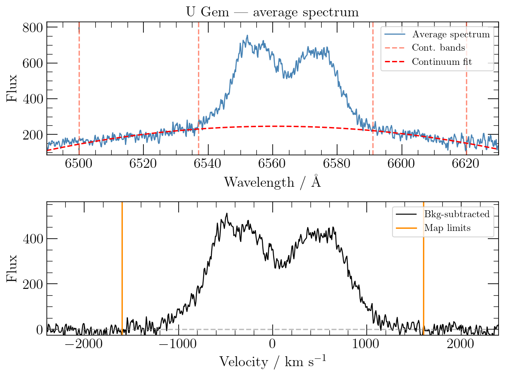
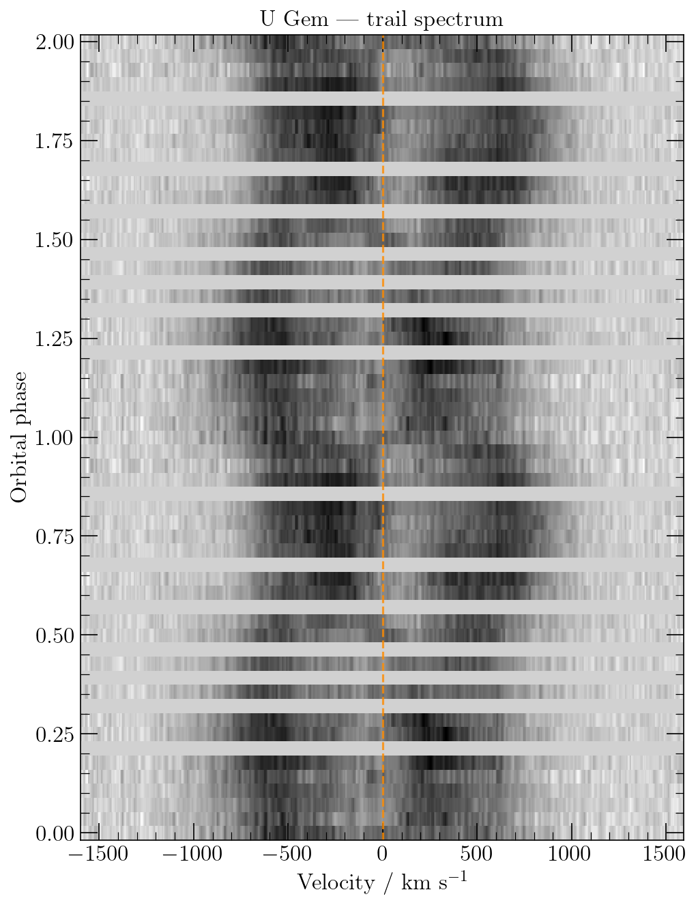
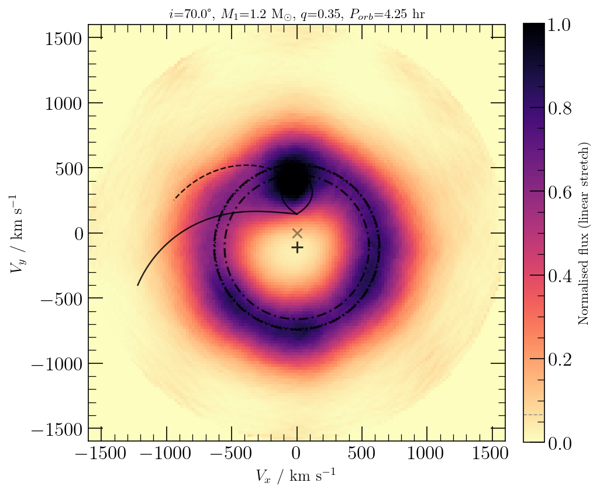
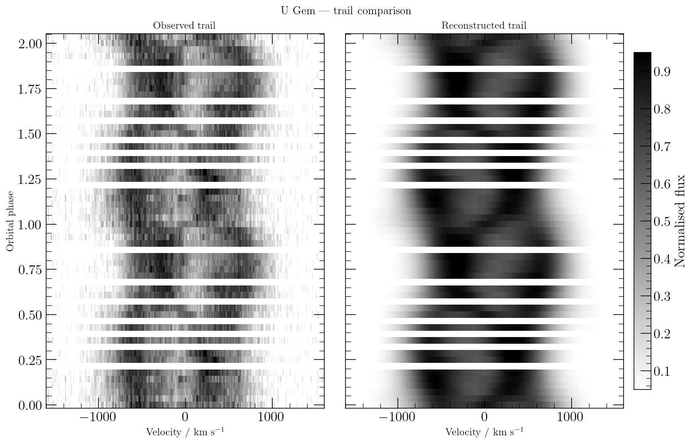

# PyDoppler

  PyDoppler is a light-weight Python package for Doppler tomography of single
  emission-line datasets, based on Henk Spruit's maximum-entropy Doppler
  tomography code. It can produce a trail spectrum of a dataset and compute
  and plot Doppler tomography maps.

  **Version 1.0 is a pure Python (NumPy/SciPy) implementation. No Fortran
  compiler is needed any more.** A full run on the test dataset takes about
  5 seconds.

  The code is able to:
  - [x] Load and normalise spectra
  - [x] Plot a trail spectrum at the initial phase resolution and binned
  - [x] Run Doppler tomography and plot the reconstructed spectra
  - [x] Run entirely in Python, with no Fortran compiler
  - [x] Auto-save figures
  - [ ] Perform initial spectra binning into user-defined phase bins
  - [ ] User-friendly functions

  The original code and IDL interface can be found at:
   *  https://wwwmpa.mpa-garching.mpg.de/~henk/

  If you have any queries, comments or bug reports, please send an e-mail to:
   * jvhs1 (at) st-andrews.ac.uk

  ## Acknowledgment

  If you make use of this software, please acknowledge the original code and this repository with the following citations:
   * Spruit 1998, arXiv, astro-ph/9806141 (https://ui.adsabs.harvard.edu/abs/1998astro.ph..6141S/abstract)
   * Hernandez Santisteban, 2021, ASCL, 6003 (https://ui.adsabs.harvard.edu/abs/2021ascl.soft06003H/abstract)

  ## Requirements & Installation

  Python >= 3.8 is required, together with `numpy`, `scipy` and `matplotlib`
  (version 3.5 or newer). These are installed automatically.

  You can download and install PyDoppler via pip. In a terminal command line, just type:

  ```
  pip install pydoppler
  ```

  If you need to upgrade the package to the latest version, you can do this with
  ```
  pip install --upgrade pydoppler
  ```

  To install the development version from a clone of this repository:
  ```
  pip install -e .
  ```

  ##  Section 1:  Usage

  There are two ways to learn the package:

  * **Tutorial notebook:** [`notebooks/PyDoppler_tutorial.ipynb`](notebooks/PyDoppler_tutorial.ipynb)
    walks through every step with explanations, all the parameters and the outputs.
  * **Sample script:** `pydoppler.test_data()` copies `sample_script.py` into your
    working directory together with the test data. It runs all the commands
    _shown in sections 2 and 3_. From a terminal:
    ```
    python sample_script.py
    ```
    or in an (i)python console:
    ```python
    run sample_script.py
    ```
    This reads all the files, normalises the spectra, performs Doppler
    tomography and saves the results. The following sections briefly
    explain each main routine.

  ##  Section 2: How to load data

  ###  Section 2.1: Test case - the accreting white dwarf - U Gem

  You can start testing PyDoppler with a test dataset kindly provided by J. Echevarria and published
  in Echevarria et al. 2007, AJ, 134, 262 (https://ui.adsabs.harvard.edu/abs/2007AJ....134..262E/abstract).
  To copy the data to your working directory, open a (i)python console and run the
  following commands:
  ```python
  import pydoppler

  pydoppler.test_data()
  ```
  This creates a subdirectory called `ugem99` in your current working directory.
  It contains a text file for each spectrum (`txhugem40*`), and also copies
  `sample_script.py`. Each spectrum file has two columns: _Wavelength_ and _Flux_.
  * Wavelength is assumed to be in Angstrom.
  * Don't use headers in the files, or start the line with a _#_ so it is ignored.

  In addition, a phase file (`ugem0all.fas`) is placed inside the `ugem99`
  directory. It lists the name of each spectrum file and its orbital phase,
  in two columns with the following format:
```
  txhugem4004 0.7150
  txhugem4005 0.7794
         .
         .
         .
```

  ###  Section 2.2: Load your data
  I recommend sticking to the same file format as the test dataset:

  * Individual spectra. Two-column files, _space separated_: Wavelength  Flux
  * Phase file. Two-column file, _space separated_: Spectrum_name  Orbital_Phase

  and the following directory tree, so that PyDoppler works properly:

  ```
  wrk_dir
  └── data_dir (your target)
      │
      ├── individual_spectra (N spectra)
      │
      └── phases_file
  ```

  ##  Section 3:  Doppler tomography tutorial
  Before running any routines, make sure you have added all the relevant
  parameters to the PyDoppler object.

  ```python
  import pydoppler
  import matplotlib.pyplot as plt

  # Load base object for tomography
  dop = pydoppler.spruit()

  # Basic data for the tomography to work
  dop.object = 'U Gem'
  dop.base_dir = 'ugem99'     # Base directory for input spectra
  dop.list = 'ugem0all.fas'   # Name of the phase file
  dop.lam0 = 6562.8           # Wavelength zero in units of the original spectra
  dop.delta_phase = 0.003     # Exposure time in terms of orbital phase
  dop.delw = 35               # Size of the Doppler map in wavelength, centred at lam0
  dop.overs = 0.3             # Between 0-1, undersampling of the spectra. 1 = full resolution
  dop.gama = 36.0             # Systemic velocity in km/s
  dop.nbins = 28              # Number of bins. Only the number of spectra is supported at the moment
  ```

  ### Section 3.1: Read the data
  This routine reads in the raw data and prepares it for further processing.
  ```python
  # Read in the individual spectra and orbital phase information
  dop.Foldspec()
  ```
  ```
  →  Found 28 spectra in ugem99/ugem0all.fas
  →  Phase bins: 28
  [██████████████████████████████] 100%  txhugem4031  φ=0.1372  npix=2048
  ✓  Loaded 28 spectra, 2048 pixels each
  ```

  ### Section 3.2: Normalise the data
  You need to define a continuum band on each side of the emission line,
  which is used to fit and subtract the continuum.
  ```python
  # Normalise the spectra
  dop.Dopin(continnum_band=[6500, 6537, 6591, 6620],
            plot_median=False, poly_degree=2)
  ```
  This saves `Average_Spec.png` (the average spectrum, continuum fit and the
  velocity window of the map) and `Trail.png` (the trail spectrum).

  <p align="middle">
     
     
  </p>

  ### Section 3.3: Run the Doppler tomography
  The maximum-entropy reconstruction runs in Python.
  ```python
  # Perform tomography
  dop.Syncdop()
  ```
  ```
  Syncdop — MEM Doppler tomography  (native Python)
  ────────────────────────────────────────────────────────────
  →  Map grid:    144 × 144 pixels
  →  Input data:  28 phases × 477 velocity channels
  →  Projection matrix: sparse, ~29 MB

  Alpha step           α     nit         χ    target
  ──────────  ──────────  ──────  ────────  ────────
  ✓  α=2.00e-03  nit=  28  χ=1.5233  (target ≤ 1.60)

  ✓  Converged!  χ = 1.5233  (target ≤ 1.60)  [0.7 s]
  →  Final α = 2.00e-03   iterations = 28
  →  Entropy S = -2.5016e+04
  ```
  The map size is set automatically from `dop.overs`. Pass `nv=` to
  `Syncdop()` to choose it yourself (e.g. `dop.Syncdop(nv=100)`).

  ### Section 3.4: Plot the tomography map
  This routine displays the result of the Doppler tomography. You can overplot
  contours and streams.
  ```python
  # Read and plot the map (defaults: linear stretch, magma_r colour map)
  fig, data = dop.Dopmap(colorbar=True)

  # Overplot the donor contours, keplerian and ballistic streams
  qm = 0.35             # mass ratio M_2 / M_1
  k1 = 107              # semi-amplitude of the primary in km/s
  inc = 70              # inclination angle, in degrees
  m1 = 1.2              # mass of the primary in solar masses
  porb = 0.1769061911   # orbital period in days

  pydoppler.stream(qm, k1, porb, m1, inc,
                   tidal_radius=True, resonance_32=True, resonance_21=True)
  ```
  <p align="middle">
     
  </p>

  Useful `Dopmap` options: `stretch='linear' | 'sqrt' | 'log'`,
  `cmaps=plt.cm.afmhot` (or any matplotlib colour map), `limits=[lo, hi]`,
  `percentile_lo` / `percentile_hi` and `smooth=True`. With dark colour maps,
  pass `colors='white'` to `stream()`.

  ### Section 3.5: Spectra reconstruction
  Always check that the reconstructed spectra look like the original ones. A good
  rule of thumb: "If a feature on the Doppler tomogram is not in the trail
  spectrum, most likely it's not real!"

  ```python
  # Plot the observed and reconstructed trail spectra
  fig, dm, dmr = dop.Reco(colorbar=True, limits=[0.05, 0.95])
  ```
  Here `fig` is the figure, and `dm` and `dmr` hold the input and reconstructed
  trail spectra (phase × velocity, baseline removed), respectively.
  <p align="middle">
     
  </p>

  ## Section 4: Extra commands
  Many other parameters control the Doppler tomogram. As usual, you can set
  them on the `pydoppler.spruit` object, as in Section 3. The configurable
  parameters are:
  ```python
  dop.ih = 0            # type of likelihood function (ih=1 for chi-squared)
  dop.iw = 0            # iw=1 if error bars are to be read and used
  dop.pb0 = 0.95        # range of phases to be ignored, between 0 and 1
  dop.pb1 = 1.05        # range of phases to be ignored, between 1 and 2
  dop.ns = 7            # smearing width in default map
  dop.ac = 8e-4         # accuracy of convergence
  dop.nim = 150         # max no of iterations
  dop.al0 = 0.002       # starting value of alpha
  dop.alf = 1.7         # factor between successive alphas
  dop.nal = 0           # max number of alphas (0 = single alpha)
  dop.clim = 1.6        # 'C-aim', target reduced chi
  dop.norm = 1          # norm=1 for normalisation to a flat light curve
  dop.overs = 0.3       # map oversampling (sets the map size)
  ```

  ## What's new in version 1.0

  * **No Fortran.** The Fortran `dop.f` engine and the `make`/`gfortran` step
    are replaced by `pydoppler/mem_engine.py`, a NumPy/SciPy implementation of
    the same algorithm (Lucy-accelerated Richardson-Lucy iteration with a
    floating-default maximum-entropy regularisation).
  * **Fast.** The projection matrix is built in vectorised form and stored as a
    sparse matrix. On the U Gem dataset, the tomography step takes about 0.7 s
    and the complete sample script about 5 s.
  * **Checked against Spruit's `dop.f`.** The projection geometry, default-map
    smoothing, entropy and its derivatives, baseline handling and alpha schedule
    follow the Fortran routines (`prom`, `chimg`, `entr`, `lamun`, `basel`,
    `alfs`). A point-source test recovers the line-of-sight velocities to
    0.000 km/s, with no velocity-channel offset.
  * **Safer alpha schedule.** When the fit stops improving (at the noise floor
    of the data), the alpha sequence falls back to geometric steps instead of
    diverging.
  * **Plots.** New defaults (linear stretch, `magma_r`), phases increase upwards
    in the reconstruction plot, and all routines save their figures.

  ## Development notes

  Version 1.0, including the conversion from Fortran to native Python, the
  performance optimisation and the line-by-line validation against Spruit's
  `dop.f`, was developed with the help of Claude, Anthropic's AI assistant,
  using **Claude Opus 5.5** (model `claude-opus-5-5`) in Claude Code.

  ## Section 5: Troubleshoot
  If you find a bug or need a feature, I will try my best to work it out. If
  you think you can add to this package, I encourage you to push new changes
  and contribute to it.
