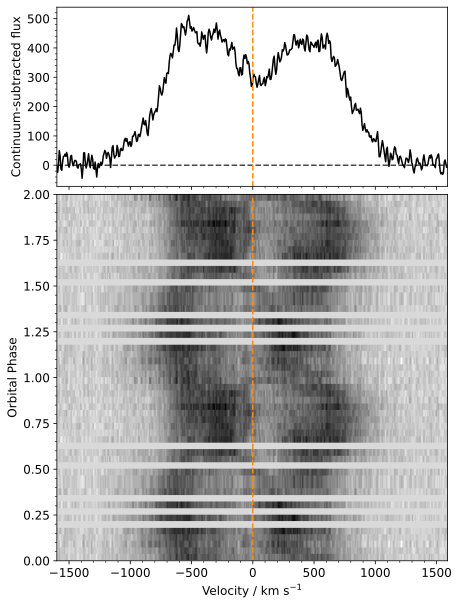
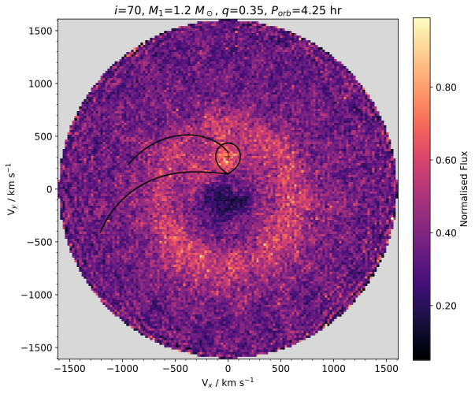
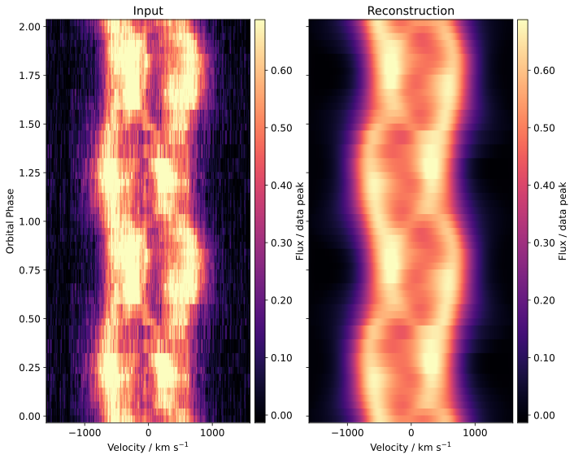

# PyDoppler

  This is a Python interface to Henk Spruit's classical maximum-entropy Doppler tomography software.
  It produces trailed spectra and Doppler tomograms for single emission-line
  datasets.
  The code will be able to:
  - [x] Load and normalise spectra
  - [x] Plot a trail spectra at initial phase resolution and binned
  - [x] Run Doppler tomography and plot reconstructed spectra
  - [ ] Perform initial spectra binning into user-defined phase bins
  - [ ] User-friendly functions
  - [x] Save example figures as PDFs.

  Scientific conventions, noise models, changed defaults, and validation are described in
  [the scientific guide](docs/scientific_conventions.md). Existing working directories
  must receive the updated solver: `pydoppler.copy_fortran_code(workdir, overwrite=True)`.
  Input spectra are preserved; this replaces the bundled solver sources and
  default configuration files in that directory.

  The original code and IDL interface can be found at:
   *  https://wwwmpa.mpa-garching.mpg.de/~henk/

  At the moment, there are many features that haven't been implemented. However, the code will be updated
  continuously. If you have any queries/comments/bug reports please send an e-mail to:
   * jvhs1 (at) st-andrews.ac.uk

  ## Acknowledgment
  
  If you make use of this software, please acknowledge the original code and this repository with the following citations:
   * Spruit 1998, arXiv, astro-ph/9806141 (https://ui.adsabs.harvard.edu/abs/1998astro.ph..6141S/abstract)
   * Hernandez Santisteban, 2021, ASCL, 6003 (https://ui.adsabs.harvard.edu/abs/2021ascl.soft06003H/abstract)

  ## Requirements & Installation

  The doppler tomography code is written in fortran. Please ensure that you have a fortran compiler installed.
  At the moment, only gfortran is supported.


  Python >=3.8 is required. CI covers Python 3.8 through 3.14; the
  Fortran-backed tomography workflow also requires ``make`` and ``gfortran``.

  You can download and install PyDoppler via pip. In a terminal command line, just type:

  ```
  pip install pydoppler
  ```

  If you need to upgrade the package to the latest version, you can do this with
  ```
  pip install --upgrade pydoppler
  ```

  ##  Section 1:  Usage

  You can use the ``sample_script.py`` file to run all the relevant commands
  _shown in sections 2 and 3_ from a terminal command line as:
  ```
  python sample_script.py
  ```
  or in a python console:
  ```python
  run sample_script.py
  ```
  This will read all the files, normalise the spectra, perform Doppler
  tomography and output the results. In the following sections, I will briefly
  explain each main routine.

  ### Quick start for automated workflows

  The package bundles helper utilities that simplify scripting and CI usage. For example:

  ```python
  from pathlib import Path

  import matplotlib.pyplot as plt
  import pydoppler

  # Keep Fortran build products + outputs isolated
  workdir = Path.cwd() / "pydoppler-workdir"
  pydoppler.copy_fortran_code(workdir)
  pydoppler.copy_test_data(workdir)

  dop = pydoppler.spruit(workdir=workdir, interactive=False)
  dop.delw = 35
  dop.overs = 0.3
  dop.base_dir = workdir / "ugem99"
  dop.list = "ugem0all.fas"
  dop.Foldspec()
  dop.Dopin(plot=False)  # continuum bands are estimated automatically
  dop.Syncdop()
  _, dopmap = dop.Dopmap(plot=False)
  ```

  When ``interactive`` is disabled, the continuum bands are determined automatically so the
  normalisation step can run in headless or automated environments. Informational output is
  routed through Python's `logging` module. Set `dop.verbose=False` to disable
  additional console output. Every inversion executes the solver; compilation is
  cached by source and executable content hashes. `dopin.json` records
  preprocessing choices and source-array hashes; `run.json` records matched
  provenance and `dop.status` records optimizer convergence and the fit statistic.

  ### Scope and physical conventions

  PyDoppler is a lightweight wrapper around Spruit's classic two-dimensional
  maximum-entropy Doppler tomography code. It is appropriate for single-line,
  phase-resolved spectroscopy when the usual assumptions of classical Doppler
  tomography are adequate:

  * the emitting pattern is fixed in the binary co-rotating frame during the
    observations;
  * velocities are projected in-plane components (including sin(inclination));
  * phase zero is the donor's inferior conjunction for the standard binary overlays;
  * the ephemeris, systemic velocity, and line rest wavelength are supplied by
    the user and dominate the physical interpretation;
  * continuum subtraction and line-window selection are part of the scientific
    model, not just plotting choices.

  Input wavelengths are assumed to be in Angstrom. ``dop.gama`` is the systemic
  velocity in km/s; positive values are treated as a redshift and removed from
  the wavelength grid before the velocity-space input file is written. The
  Python plotting API reports velocities in km/s, while the Fortran input file
  uses cm/s internally. Orbital phases are in cycles, and an optional third
  column in the phase file can supply each full exposure width in phase units.
  Phases refer to mid-exposure. The convention is
  `v_rest = -Vx*cos(2*pi*phase) + Vy*sin(2*pi*phase)`; in the usual
  nonrelativistic approximation `v_rad = gamma + v_rest`.
  Input spectra, systemic velocity, and rest wavelength must use consistent
  barycentric/heliocentric and air/vacuum conventions; PyDoppler does not apply
  those calibrations. The wavelength conversion uses the relativistic longitudinal
  Doppler formula, which differs from the optical `v=c*z` convention.

  No phases are excluded and no phase-dependent flux normalization is applied
  by default. Select eclipse exclusions deliberately with `pb0,pb1`.
  `instrument_sigma` specifies Gaussian instrumental broadening in km/s; its
  default is zero. Finite exposures are integrated by phase quadrature.
  `delw` is a wavelength **half-width**, so the fitted window spans `lam0 ± delw`.

  This is not a full state-of-the-art tomography framework. It does not perform
  modulation tomography, 3D tomography, multi-line joint modelling, Bayesian
  uncertainty propagation, or automated ephemeris/system-parameter inference.
  Use residuals, reconstructed trails, phase coverage, and simulations to check
  whether a map feature is demanded by the data.

  ##  Section 2: How to load data

  ###  Section 2.1: Test case - the accreting white dwarf - U Gem

  You can start to test PyDoppler with a test dataset kindly provided by J. Echevarria and published
  in Echevarria et al. 2007, AJ, 134, 262 (https://ui.adsabs.harvard.edu/abs/2007AJ....134..262E/abstract).
  To copy the data to your working directory, open a (i)python console and run the
  following commands:
  ```python
  import pydoppler

  pydoppler.test_data()

  ```
  This will create a subdirectory (called ugem99) in your current working directory
  which will contain text files for each spectra (txhugem40*). The format of
  each spectrum file is two columns: _Wavelength_ and _Flux_ (an optional third
  column can provide 1σ flux uncertainties). Flux values are samples of spectral
  density in arbitrary consistent units, not integrated pixel counts. Convert
  pixel-integrated measurements to a density before using this interpolation pipeline.
  * Wavelength is assumed to be in Angstrom.
  * Don't use headers in the files or us a _#_ at the start of the line, so it
  will be ignored.

  In addition, a phase file (ugem0all.fas) will be added inside the ugem99
  directory which contains the name
  of each spectrum file and its corresponding orbital phase.
  This is a two- or three-column file with the following format:
```
  txhugem4004 0.7150
  txhugem4005 0.7794
         .
         .
         .
```

  ###  Section 2.2: Load your data
  I recommend to stick to the previous file format (as in the test dataset):

  * Individual spectra. Two- or three-column files, _space separated_: Wavelength  Flux  [Flux_Error]
  * Phase file. Two- or three-column file, _space separated_: Spectrum_name  Orbital_Phase  [Delta_Phase]

  and the following directory tree in order for PyDoppler to work properly:

  ```
  wrk_dir
  ├── data_dir (your target)
  │   │
  │   ├── individual_spectra (N spectra)
  │   │
  │   └── phases_file
  │
  └── fortran_code_files
  ```

  ##  Section 3:  Doppler tomography tutorial
  Before running any routines, verify that you have added all the relevant
  parameters into the PyDoppler object.

  * _NOTE:_ PyDoppler runs the Fortran code inside ``dop.workdir`` (defaults to
  ``./pydoppler-workdir``) and writes ``dopin``, ``dop.in``, ``dop.out`` and ``dop.log``
  there. Copy the bundled Fortran sources into that directory with
  ``pydoppler.copy_fortran_code(dop.workdir)`` (or set ``auto_install=True`` when
  constructing the object). Use ``dop.make_run_dir()`` to create a fresh run
  directory when running multiple maps.

  ```python
  from pathlib import Path

  import matplotlib.pyplot as plt
  import pydoppler

  # Load base object for tomography
  dop = pydoppler.spruit(workdir=Path.cwd() / "pydoppler-workdir")
  pydoppler.copy_fortran_code(dop.workdir)

  # Basic data for the tomography to work
  dop.object = 'U Gem'
  dop.base_dir = 'ugem99' # Base directory for input spectra
  dop.list = 'ugem0all.fas'		# Name of the input file
  dop.lam0 = 6562.8 # Wavelength zero in units of the original spectra
  dop.delta_phase = 0.003  # Exposure time in terms of orbital phase
  dop.delw = 35	# wavelength half-width about lam0, in Angstrom
  dop.overs = 0.3 # map pixels per axis relative to spectral-channel count; (0,1]
  dop.gama = 36.0  # Systemic velocity in km /s
  dop.nbins = 28  # phase bins for diagnostic trail plots (tomography uses all spectra)
  ```

  ### Section 3.1: Read the data
  This routine reads in the raw data and prepares the files for further
  processing.
  ```python
  # Read in the individual spectra and orbital phase information
  dop.Foldspec()
  ```
  ```
  001 txhugem4004  0.715 2048
  002 txhugem4005  0.7794 2048
  003 txhugem4006  0.8348 2048
  004 txhugem4007  0.8942 2048
  005 txhugem4008  0.9518 2048
  006 txhugem4009  0.0072 2048
  007 txhugem4010  0.0632 2048
  008 txhugem4011  0.1186 2048
  009 txhugem4012  0.1745 2048
  010 txhugem4013  0.2344 2048
  011 txhugem4014  0.2904 2048
  012 txhugem4015  0.3724 2048
  013 txhugem4016  0.4283 2048
  014 txhugem4017  0.4866 2048
  015 txhugem4018  0.5425 2048
  016 txhugem4019  0.5979 2048
  017 txhugem4020  0.6544 2048
  018 txhugem4021  0.7098 2048
  019 txhugem4022  0.7652 2048
  020 txhugem4023  0.8195 2048
  021 txhugem4024  0.8772 2048
  022 txhugem4025  0.9269 2048
  023 txhugem4026  0.9614 2048
  024 txhugem4027  0.9959 2048
  025 txhugem4028  0.0304 2048
  026 txhugem4029  0.0648 2048
  027 txhugem4030  0.1027 2048
  028 txhugem4031  0.1372 2048
```

  ### Section 3.2: Normalise the data and set Doppler files
  Define two continuum bands in the **observed wavelength frame**, one on each
  side of the line. The polynomial continuum is subtracted; flux is not divided
  by the continuum. Automatic bands use the outer 5% of the available coverage
  and must be checked for other lines or instrumental artifacts. The normalised spectra are written to
  ``dopin`` inside ``dop.workdir``.

  If your phase file includes a third column with per-spectrum exposure widths
  in orbital phase, pass ``use_list_dpha=True`` to :meth:`Dopin` to write those
  values into ``dopin``.
  ```python  
  # Normalise the spectra
  dop.Dopin(continuum_band=[6500,6537,6591,6620],
            plot_median=False, poly_degree=2)
  ```


  <p align="middle">
     
  </p>

  ### Section 3.3: Run the Fortran code
  Now, let's run the tomography software!
  ```python
  # Perform tomography
  dop.Syncdop()
  ```

  The main outputs are written into ``dop.workdir``:
  ``dop.log`` (iteration log), ``dop.out`` (tomogram + reconstructions),
  ``dop.status`` (convergence/statistic), and ``run.json`` (input/output hashes).
  Failed runs raise an exception and cannot be plotted as successful results.
  ``clim`` is an RMS target, **not reduced chi-square**. With `iw=0`, it is
  relative RMS and carries no noise-based significance. With supplied errors, it
  is the RMS standardized residual, using covariance rank as the denominator.

  To use measured errors and their propagated covariance, set `dop.iw=1` **before**
  calling `Dopin()`. The weighted solver uses a Gaussian likelihood and full
  covariance by default. `dop.covariance_mode="diagonal"` explicitly requests the
  independence approximation. If no errors are supplied, `Dopin` estimates a
  per-spectrum constant noise level from continuum residuals; a noiseless or
  underdetermined continuum raises rather than inventing errors.
  `estimate_errors=False` requires valid supplied errors. A target near one is
  meaningful only under an adequate noise and physical model; inspect residuals
  and sensitivity to continuum windows and regularization.
  ### Section 3.4: Plot the tomography map
  This routine will display the outcome of the Doppler tomography. You can overplot
  contours and streams.
  ```python
  # Read and plot map
  cb,data = dop.Dopmap(limits=[0.05,0.99],colorbar=True,cmaps=plt.cm.magma,
  					smooth=False,remove_mean=False)
  # Overplot the donor contours, keplerian and ballistic streams
  qm=0.35   # mass ratio M_2 / M_1
  k1 = 107  # Projected primary semi-amplitude in km/s; sets overlay scale
  inc=70    # inclination angle, in degrees
  m1=1.2    # Mass of the primary in solar masses
  porb=0.1769061911  # orbital period in days


  pydoppler.stream(qm,k1,porb,m1,inc)
  ```
  <p align="middle">
     
  </p>

  ### Section 3.5: Spectra reconstruction
  Always check that reconstructed spectra looks like the original one. A good
  rule of thumb "If a feature on the Doppler tomogram is not in the trail
  spectrum, most likely its not real!"

  ```python
  # plot trail spectra
  cb2,cb3,dmr,dm = dop.Reco(colorbar=True,limits=None,cmaps=plt.cm.magma)
  ```
  `cb2` and `cb3` hold colorbar objects (or `None`). `dmr` and `dm` contain
  the reconstructed and input spectra at the original phases, with shape
  `(n_velocity, n_spectra)`. Only the displayed trails are phase-binned. Data
  and model share one display scale, with phases increasing upwards.
  <p align="middle">
     
  </p>

  ### Section 3.6: Residual diagnostics
  Residual arrays can be computed without generating an extra figure.

  ```python
  residuals, norm_residuals = dop.Residuals(dm=dm, dmr=dmr)
  # For a weighted run with full prepared covariance:
  # residuals, whitened = dop.Residuals(whiten=True)
  ```

  `norm_residuals` is `None` when no actual errors are available. No Poisson
  error is inferred from calibrated or continuum-subtracted flux. Excluded
  phases are masked in residual diagnostics.

  ## Section 4: Extra commands
  There are many other commands that will interact with the Doppler tomogram. As
  usual, you can update them inside the pydoppler.spruit object as we did in
  section 3. The configurable parameters are:
  ```python3
  dop.ih = 0            # legacy positive log objective; 1=unweighted least squares
  dop.iw = 0            # 1=Gaussian fit using provided/estimated noise; 0=unweighted
  dop.pb0 = 0.0         # open exclusion interval, repeated every orbit
  dop.pb1 = 0.0         # equal bounds exclude nothing; .95,1.05 would exclude eclipse
  dop.ns = 7            # default-map Gaussian kernel exp(-r^2/ns^2), in pixels
  dop.ac = 8e-4         # optimizer stationarity tolerance
  dop.nim = 1000        # max iterations per regularization value
  dop.al0 = 0.002       # starting entropy weight alpha
  dop.alf = 1.7         # divide alpha by this factor for each subsequent attempt
  dop.nal = 0           # number of alpha values to try; 0 means just al0
  dop.clim = 1.6        # RMS target: relative flux (iw=0) or standardized noise (iw>=1)
  dop.ipri = 2          # printout control for standard output channel (ipr=2 for full)
  dop.norm = 0          # preserve observed phase-dependent flux (recommended)
  dop.wid = 10e5        # velocity scale in cm/s of empirical absorption prescription
  dop.af = 0.0          # empirical absorption amplitude; zero disables it
  dop.instrument_sigma = 0.0  # Gaussian LSF sigma in km/s (not FWHM)
  dop.phase_subsamples = 0    # adaptive quadrature; positive value sets minimum samples
  dop.covariance_mode = "full"
  dop.map_size = None    # optional explicit even map size; otherwise derived from overs
  ```

  ## Section 5: Troubleshoot
  This is an early version of the wrapper. Things will go wrong. If you find a
  bug or need a feature, I will try my best to work it out. If you think you can
  add to this wrapper, I encourage you push new changes and contribute to it.
